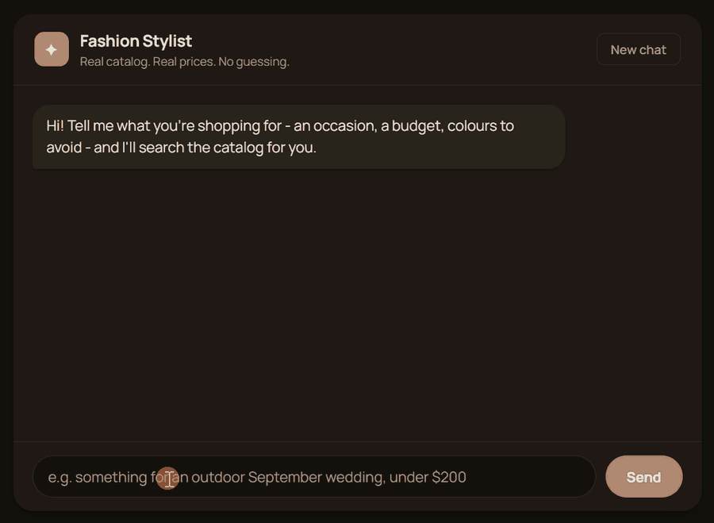

# Fashion MCP - Authenticated Styling Agent

**Live demo:** [fashion-mcp-frontend.onrender.com](https://fashion-mcp-frontend.onrender.com)
**Backend API:** [fashion-mcp-backend.onrender.com](https://fashion-mcp-backend.onrender.com)

Both are on Render's free tier and spin down after ~15 minutes idle, so the
first request after a lull can take 20-30s to wake up - that's a cold
start, not a bug.



Imagine a personal stylist you can text: *"I need something for an outdoor
September wedding, under $200, and I already own gold jewellery."* Instead of
scrolling through filters, you just describe what you need, and the assistant
figures out the rest.

Behind that simple chat is a real system with three parts: a **catalog**
(44,000+ real garments in a cloud Postgres database), a **toolbox** (an MCP
server exposing authenticated, audit-logged actions - search, check stock,
save to a wishlist), and an **agent** that decides which tools to call and
pauses for your confirmation before doing anything permanent.

The interesting engineering isn't the styling advice, it's that part: the
agent can only take actions it's explicitly allowed to take, always knows
who it's acting on behalf of, and never writes anything without asking
first - and every attempt, successful or not, ends up in an audit log.

**Status: Deployed** - MCP server with 4 tools, auth, audit logging, and
rate limiting. Agent layer: multi-turn LangGraph state machine with Groq as
the primary LLM and Gemini as fallback, a human-confirmation gate on write
actions, and conversation state checkpointed to Postgres so a restart
doesn't drop in-progress chats. Served over a FastAPI backend to a React +
TypeScript (Next.js) chat frontend.

## Why this exists

Built to demonstrate production-shaped agent infrastructure: authentication,
per-user scoping, and an auditable action log - not just an LLM wrapper.

## Stack

- Backend: Python, FastAPI, MCP Python SDK, LangGraph (Groq primary, Gemini fallback)
- Frontend: React, TypeScript, Next.js (static export)
- Data: PostgreSQL (Neon) via `psycopg` - catalog, wishlist, audit log, and LangGraph checkpoints
- CI: GitHub Actions; hosting: Render
- Data: Kaggle Fashion Product Images dataset (44,417 garments)
- Pricing and stock are deterministically simulated (seeded from item ID),
  clearly noted since the source dataset has no real price/inventory data

## Tools

| Tool | Description | Auth required |
|---|---|---|
| `search_garments` | Filter catalog by type, colour, price | No |
| `check_availability` | Stock check by garment + size | No |
| `get_care_instructions` | Fabric and care instructions for a garment | No |
| `save_to_wishlist` | Add item to a user's wishlist | Yes (API key) |

Every call to `save_to_wishlist` is logged to `audit_log` with user id,
arguments, result, and latency. The write happens in a `finally` block, so
failed auth, rate-limited, not-found, and even crashed attempts are all
recorded - a test forces an exception mid-call to prove it.

## Engineering notes

This project is documented not just as a working demo but as a running log
of the real bugs found and fixed while building and deploying it - a tool
registration ordering bug, LLM/database value mismatches, a Gemini hang
that defeated the multi-provider fallback, an MCP subprocess that silently
lost its database credentials on deploy, and a dozen more. See
**[ENGINEERING_NOTES.md](ENGINEERING_NOTES.md)** for the full,
chronological write-up of each one, what broke, how it was diagnosed, and
what actually fixed it.

## Evaluation harness

`eval_harness.py` has 20 tests. Most drive the agent through its real HTTP
API and check each response against ground truth pulled directly from the
database - not just that the agent replies, but that the reply is *true*.
Six are deterministic and run against the database directly with no LLM:
auth rejection, the not-found path, audit-on-failure, rate limiting,
`article_type` normalization, and a pending confirmation surviving a
restart. See
[ENGINEERING_NOTES.md](ENGINEERING_NOTES.md#evaluation-harness-details) for
exactly what the harness checks and why.

```bash
python eval_harness.py --base-url http://127.0.0.1:8000
python eval_harness.py --base-url https://fashion-mcp-backend.onrender.com  # live deploy
python eval_harness.py --suite deterministic                               # no LLM, no server
```

CI (`.github/workflows/ci.yml`) runs the frontend lint/type-check/build and
the deterministic suite on every push, and the full suite against the live
deploy nightly. The LLM-driven tests stay off the per-push path on purpose:
run back to back they trip Groq's 8,000 tokens/minute free-tier limit, which
would make every push flaky.

## Running locally

```bash
python -m venv .venv
source .venv/bin/activate  # Windows: .venv\Scripts\activate
pip install -r requirements.txt

# .env file with DATABASE_URL, GROQ_API_KEY, GEMINI_API_KEY

python load_data.py                                 # one-time: load catalog into Postgres
uvicorn web_server:app --host 127.0.0.1 --port 8000 # backend (activate the venv first -
                                                    # it spawns server.py with `python`)

cd frontend-next && npm install && npm run dev      # frontend on http://localhost:3000
```

On Windows, local dev keeps conversation state in memory: psycopg's async
mode can't run on the event loop the MCP subprocess needs. Render (Linux)
uses the Postgres checkpointer.

`mcp dev server.py` launches the MCP Inspector to call the tools directly.

## Roadmap

- [x] `get_care_instructions` tool
- [x] Rate limiting on write actions
- [x] Real MCP client-server connection (not a direct import)
- [x] Gemini function-calling: LLM selects the correct tool and arguments
- [x] Execute the tool call Gemini requests and feed results back
- [x] Multi-turn conversation loop
- [x] LangGraph state machine with human-in-the-loop confirmation gate
- [x] Simple chat UI
- [x] Public deployment (Render)
- [x] Evaluation harness (task success rate, groundedness)
- [x] Demo GIF
- [x] React + TypeScript (Next.js) frontend
- [x] Conversation state in Postgres (survives restarts)
- [x] GitHub Actions CI

Known limitations, including in-memory rate limiting, are noted in
[ENGINEERING_NOTES.md](ENGINEERING_NOTES.md).
